# Guida all'uso di Naibi

Naibi è un'app per creare carte e altri elementi di gioco stampati a partire da un foglio di calcolo. Si disegna una volta il modello della carta, il **template**, e ogni riga del foglio diventa una carta. Le carte si esportano come immagini, come PDF da stampare o come mazzi per Tabletop Simulator.

Questa guida segue l'ordine in cui di solito si lavora: creare un progetto, disegnare un template, inserire le carte, rifinire testi e immagini, esportare. Gli esempi vengono da un piccolo progetto con tre set: personaggi, oggetti e carte mercato.

English version: [../guide/README.md](../guide/README.md).

## Indice

1. [Concetti di base](#1-concetti-di-base)
2. [Schermata di ingresso](#2-schermata-di-ingresso)
3. [La finestra del progetto](#3-la-finestra-del-progetto)
4. [Disegnare un template](#4-disegnare-un-template)
5. [Inserire e modificare le carte](#5-inserire-e-modificare-le-carte)
6. [Testo e markup](#6-testo-e-markup)
7. [Variabili e stili](#7-variabili-e-stili)
8. [Immagini, icone e font](#8-immagini-icone-e-font)
9. [Formule e campi calcolati](#9-formule-e-campi-calcolati)
10. [Generare le carte](#10-generare-le-carte)
11. [Esportare](#11-esportare)
12. [Documenti](#12-documenti)
13. [Backup](#13-backup)
14. [Importare da Tabletop Creator](#14-importare-da-tabletop-creator)
15. [Lavorare con un agente IA](#15-lavorare-con-un-agente-ia)
16. [I file del progetto](#16-i-file-del-progetto)
17. [Scorciatoie da tastiera](#17-scorciatoie-da-tastiera)

## 1. Concetti di base

| Termine       | Cos'è                                                                                                                                 |
| ------------- | ------------------------------------------------------------------------------------------------------------------------------------- |
| **progetto**  | una cartella sul disco con il file `naibi.json`, il file dei dati, i template e gli asset                                             |
| **template**  | il disegno di una carta: formato, abbondanza e una pila di **livelli** (testi, immagini, forme, gruppi), per il fronte e per il retro |
| **set**       | un gruppo di carte che usano lo stesso template; corrisponde a un foglio del file dati (`data/carte.xlsx`)                            |
| **livello**   | un elemento del template. Il nome del livello è anche il nome della colonna del foglio da cui prende il valore                        |
| **asset**     | immagini, icone e font del progetto, nella cartella `assets/`                                                                         |
| **variabile** | un nome che si richiama nei testi con `{nome}`: un'icona, un testo formattato, un colore o un valore                                  |
| **stile**     | un insieme di attributi del testo con un nome, da applicare a un livello, a un paragrafo o a una parola                               |

Il collegamento tra dati e disegno è sempre lo stesso: nel template il livello di testo `nome` mostra, su ogni carta, il contenuto della colonna `nome` della riga corrispondente.

Le misure sono in millimetri, le dimensioni del testo in punti. Le parole chiave del markup e delle formule sono in inglese e non cambiano con la lingua dell'interfaccia.

## 2. Schermata di ingresso

All'avvio Naibi mostra la schermata di ingresso.

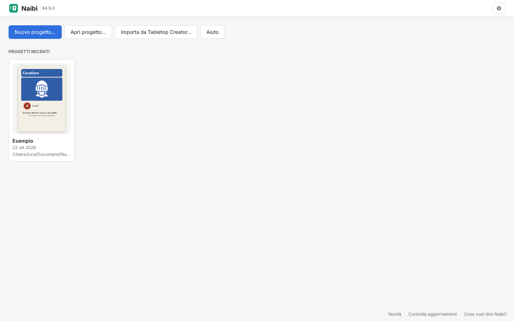

- **Nuovo progetto…** crea una cartella vuota con la struttura di un progetto.
- **Apri progetto…** apre una cartella che contiene `naibi.json`.
- **Importa da Tabletop Creator…** converte un progetto di Tabletop Creator ([capitolo 14](#14-importare-da-tabletop-creator)).
- **Strumenti IA…** prepara un agente IA a lavorare sui progetti ([capitolo 15](#15-lavorare-con-un-agente-ia)).
- **Progetti recenti** mostra fino a 24 progetti, con la prima carta come miniatura. La × toglie un progetto dall'elenco senza cancellare la cartella.

In alto a destra si scelgono la dimensione dell'interfaccia, il tema (chiaro, scuro o quello del sistema) e la lingua (inglese o italiano).

Quando esce una versione nuova, all'avvio compare una striscia in cima alla finestra: **Novità** mostra cosa cambia, **Aggiorna e riavvia** scarica la versione nuova, la installa e riapre Naibi. Questo vale per Naibi installato con il setup su Windows, per l'AppImage su Linux e sul Mac per l'app in Applicazioni (o in un'altra cartella in cui puoi scrivere); se ci sono modifiche non salvate Naibi lo chiede prima. La versione portatile di Windows, il pacchetto .deb e un'app aperta dal disco scaricato hanno invece **Scarica**, che apre la pagina da cui scaricarla; lo stesso succede se l'aggiornamento automatico non riesce. **Salta questa versione** non la segnala più, **Ricordamelo più tardi** la nasconde fino al prossimo avvio.

Per creare un progetto si scrivono il nome e la posizione. Di base la posizione è `Documenti/Naibi`; il file dei dati può essere Excel (`.xlsx`, consigliato) o OpenDocument (`.ods`).

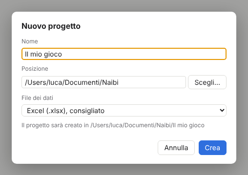

Un progetto nuovo è vuoto: l'app suggerisce di creare prima un template e poi un set che lo usa.

## 3. La finestra del progetto

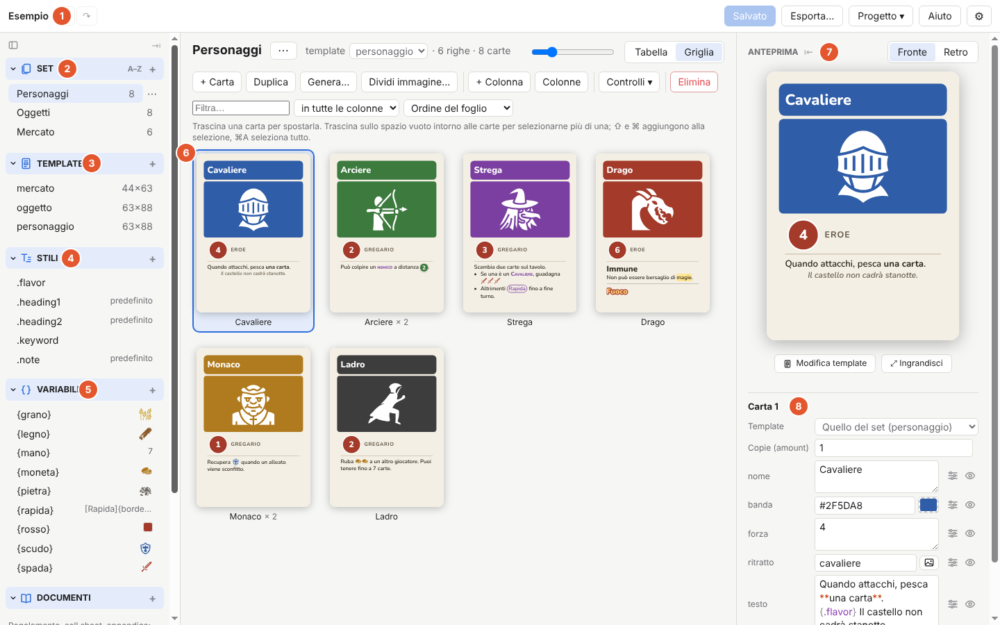

1. **Barra in alto.** Nome e cartella del progetto, annulla e ripristina (valgono per ciò che è aperto: le carte, stili e variabili, o il template nell'editor), **Esporta…**, **Backup…**, **Strumenti IA…**, **Aiuto** (F1, [capitolo 6](#6-testo-e-markup)), **Salva** (⌘S), **Ricarica** (rilegge il progetto dal disco, perdendo le modifiche non salvate) e **Chiudi**.
2. **Set.** Un clic apre le carte del set; il numero è il totale delle carte, copie comprese.
3. **Template.** Un clic apre il template nell'editor; accanto c'è il formato in millimetri.
4. **Stili** di testo del progetto ([capitolo 7](#7-variabili-e-stili)).
5. **Variabili** del progetto, con un'anteprima.
6. **Carte del set**, in tabella o in griglia.
7. **Anteprima** della carta selezionata, fronte o retro. **Modifica template** apre il template della carta, cioè quello del set o quello scelto per la carta; **Ingrandisci** apre la carta grande con il modulo accanto.
8. **Campi della carta** selezionata, modificabili come le celle della tabella.

Accanto al nome del set o del template aperto ci sono i pulsanti per rinominarlo, duplicarlo, eliminarlo e, per un template, crearne un derivato. Rinominando un set cambia nome anche il suo foglio nel file dei dati (se il foglio è già nel file Naibi prima chiede, perché le formule di altri fogli che lo citano si romperebbero); rinominando un template cambia nome il suo file, e il nome nuovo va nei set, nei derivati e nella colonna `template` delle carte che lo usano. I file cambiano nome quando si salva. Un template eliminato va nella cartella `deleted` del progetto. Anche il foglio di un set eliminato, al salvataggio, esce dal file dei dati e va in `deleted` come file a sé, così il suo nome torna libero. **Cestino…** nella barra in alto elenca quello che c'è in `deleted` (template, set, note e documenti, dal più recente) e **Ripristina** rimette un elemento nel progetto: un set prende il template scelto (Naibi propone quello con più colonne in comune), un nome già usato riceve un numero. Template e set ripristinati escono dal cestino quando si salva. Le voci della barra laterale si riordinano trascinandole; il + accanto a ciascun titolo crea un elemento nuovo. Stili e variabili si dividono in gruppi con il campo **Gruppo** della loro finestra: le voci di un gruppo stanno sotto il suo titolo, che si chiude e si apre con un clic, dopo quelle senza gruppo. Una voce trascinata sul titolo di un gruppo entra nel gruppo; trascinata su un'altra voce prende il gruppo di quella voce (anche nessuno). Con più di 12 voci compare sopra l'elenco un campo per filtrarle per nome. Nella finestra di uno stile o di una variabile, **Dove si usa** elenca i template (con i livelli), i set (con i numeri delle carte) e le altre variabili e stili che lo richiamano; un clic su un template o su un set lo apre. Soffermando il mouse su una voce compare un'anteprima: le prime carte di un set, fronte e retro di un template, una frase con lo stile, l'icona o il colore di una variabile. Nella sezione **Note** si tengono appunti sul progetto: il + crea una nota, un clic la apre in un pannello accanto a qualsiasi schermata, dove si scrive in Markdown (con **Anteprima** per vederla formattata) e si rinomina dal titolo. Una nota già scritta si apre in **Anteprima**, una nuova pronta per scrivere. Le note si salvano da sole mentre si scrive, come file `notes/<nome>.md` del progetto; il cestino le sposta in `deleted`. Un'IA che lavora sul progetto le legge con `naibi notes`. Il pulsante in alto a sinistra riduce la barra a sole icone, e le frecce accanto ai titoli dei pannelli li spostano dall'altro lato della finestra.

Le modifiche restano in memoria finché non si salva. Il pulsante **Salva** diventa **Salvato** quando non c'è nulla da scrivere.

## 4. Disegnare un template

### 4.1 Creare un template

Il + accanto a **Template** apre la finestra del nuovo template: nome, formato (poker, bridge, mini, tarocchi, quadrata, A6 o personalizzato) e misure. Il lucchetto tra larghezza e altezza mantiene le proporzioni.

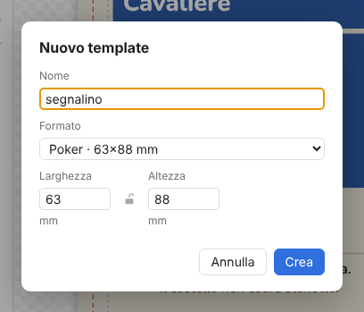

### 4.2 L'editor

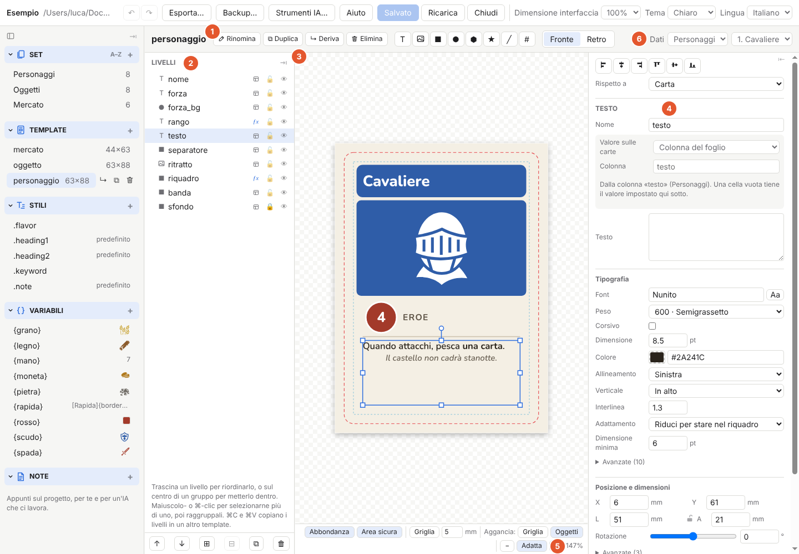

1. **Strumenti** per aggiungere un livello: testo (T), immagine, rettangolo (R), ellisse (E), poligono, stella, linea e valore (#). **Fronte** e **Retro** passano da un lato all'altro della carta; le frecce annullano e ripetono.
2. **Livelli**, dall'alto in basso come si sovrappongono sulla carta. Accanto a ogni livello c'è la fonte del valore (colonna del foglio o _fx_ per una formula), il lucchetto e l'occhio per nasconderlo.
3. **Tela** con la carta. Il tratteggio rosso è il bordo di taglio, l'area esterna è l'abbondanza, il tratteggio azzurro l'area sicura.
4. **Proprietà** del livello selezionato, o del template se non è selezionato nulla.
5. **Barra della tela**: mostra o nasconde abbondanza, area sicura e griglia, sceglie a cosa agganciarsi (griglia, oggetti) e regola lo zoom.
6. **Dati**: disegna la tela con i valori di una carta di un set, invece dei valori del template.

Sulla tela i livelli si spostano trascinandoli, si ridimensionano con le maniglie e si ruotano con la maniglia rotonda in alto (Maiuscolo per scatti di 15°). Tenendo premuto Maiuscolo mentre si sposta, il livello si muove solo in orizzontale, in verticale o a 45°, secondo la direzione più vicina. Ridimensionando, Maiuscolo inverte il blocco delle proporzioni (le mantiene se sono libere, le libera se sono bloccate) e ⌘ (Ctrl su Windows) ridimensiona dal centro; i due si possono combinare. Durante il trascinamento i bordi si agganciano alla griglia, agli altri livelli e alle guide; tenendo premuto Alt si trascina liberamente. Alt+clic seleziona il livello che sta sotto quello selezionato, nello stesso punto: serve quando un livello più grande ne copre altri. Le frecce della tastiera spostano il livello di 0,5 mm, con Maiuscolo di 5 mm.

Nell'elenco dei livelli si trascina un livello per cambiarne l'ordine, o sul centro di un gruppo per metterlo dentro. Con Maiuscolo o ⌘ si selezionano più livelli; ⌘G li raggruppa. Con più livelli selezionati il pannello delle proprietà mostra le voci che hanno in comune (opacità, rotazione, visibilità, e quelle del tipo se sono tutti dello stesso tipo, per esempio colore e dimensione del testo): una modifica vale per tutti. I campi mostrano i valori del primo livello selezionato.

I livelli selezionati si copiano con ⌘C (⌘X per tagliarli) e si incollano con ⌘V in un altro template, anche di un altro progetto, o nello stesso. Arrivano con tutte le proprietà, sopra al livello selezionato. Se il template ha già un livello con lo stesso nome, quello incollato prende un nome nuovo (per esempio `nome_2`) ma continua a leggere la colonna di prima. Nello stesso template la copia è spostata di 2 mm per non coprire l'originale.

### 4.3 Le proprietà del template

Senza livelli selezionati, il pannello mostra le proprietà del template: misure, abbondanza (di base 3 mm), margine dell'area sicura, forma della carta (rettangolo con angoli arrotondati, cerchio o ellisse, esagono, sagoma presa da un'immagine), guide manuali e **Nome delle carte**, il campo che compare sotto ogni carta nella griglia. L'esagono è sempre regolare, il più grande che sta nella carta: per riempirla il lato corto deve essere il lato lungo × 0,866, e il pulsante **Adatta la carta all'esagono** cambia così il lato corto. Nelle forme poligono e stella, **Rendi regolare** porta il riquadro a un quadrato attorno allo stesso centro, così lati e angoli sono tutti uguali.

Quando si cambiano le misure di un template che ha già dei livelli, l'app chiede se scalare i livelli in proporzione o lasciarli dove sono. Nel secondo caso ogni livello segue i suoi **vincoli** (resta a sinistra, segue il bordo destro, si allarga con la carta e così via).

### 4.4 Le proprietà dei livelli

Il pannello delle proprietà è diviso in sezioni. Ogni sezione mostra le voci più usate e raccoglie le altre in **Avanzate**. Passando con il mouse su una voce compare una freccia che la sposta in Avanzate o la riporta fuori; la disposizione vale per tutti i progetti.

Nei campi numerici si può trascinare l'etichetta a destra o a sinistra per cambiare il valore come con un cursore (Maiuscolo per passi più grandi, Alt per passi più fini); rotazione e opacità hanno anche un cursore accanto alla casella.

<table>
<tr>
<td width="33%">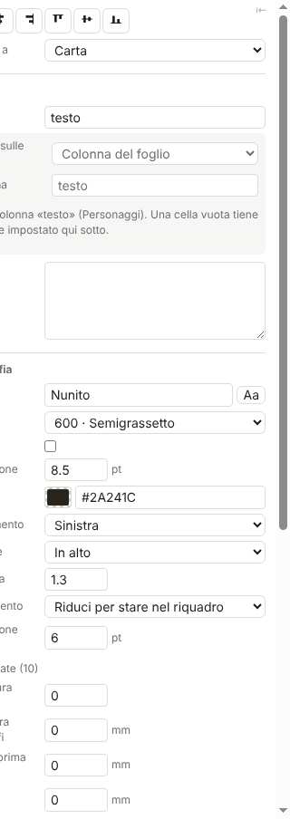</td>
<td width="33%">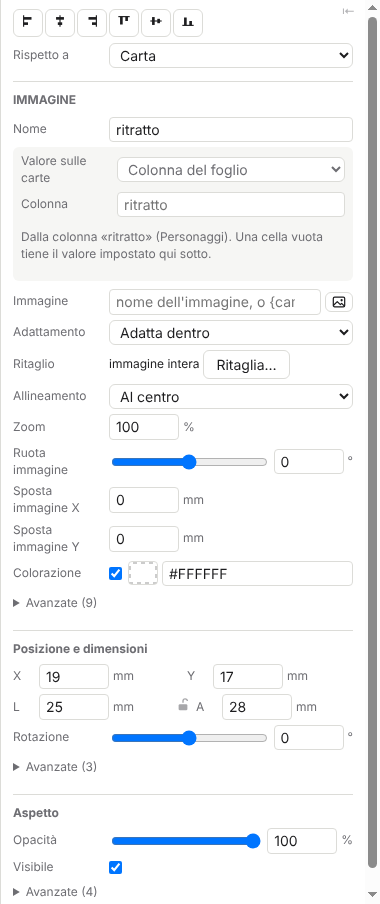</td>
<td width="33%">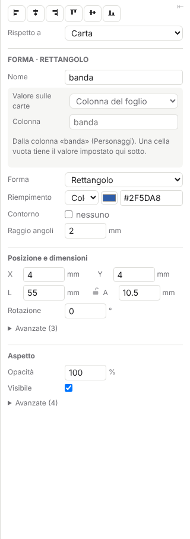</td>
</tr>
<tr>
<td>Testo</td>
<td>Immagine</td>
<td>Forma</td>
</tr>
</table>

In cima a ogni livello ci sono il **nome**, che è anche il nome della colonna del foglio, e il **valore sulle carte**:

- **Colonna del foglio**: di base quella con lo stesso nome del livello. Una cella vuota lascia il valore scritto nel template.
- **Fisso**: lo stesso valore su tutte le carte.
- **Formula**: il valore si calcola dagli altri campi della carta ([capitolo 9](#9-formule-e-campi-calcolati)).

Le proprietà principali per tipo di livello:

- **Testo**: contenuto, stile, font, peso, dimensione, colore, allineamento orizzontale e verticale, interlinea, adattamento (riduci per stare nel riquadro, taglia al bordo, lascia uscire). In Avanzate spaziature, rientro, margini interni, maiuscole, sottolineato, barrato, a capo automatico e contorno delle lettere.
- **Immagine**: nome del file o della variabile, adattamento (riempi ritagliando, riempi lasciando uscire la parte fuori dal riquadro, adatta dentro, allunga, dimensione originale, ripeti), allineamento, zoom, rotazione dell'immagine dentro il riquadro, spostamento, colorazione e ritaglio. **Ritaglia…** mostra l'immagine intera con un rettangolo da spostare e ridimensionare: il livello usa solo quella parte, senza modificare il file. Il rettangolo può tenere le proporzioni del riquadro del livello; × toglie il ritaglio. Se il nome dell'immagine viene da una colonna, il ritaglio si prova sull'immagine della carta mostrata e vale per tutte le carte. In Avanzate riflessioni, regolazioni (scala di grigi, luminosità, contrasto, saturazione), raggio, contorno e cosa fare se l'immagine manca.
- **Forma**: tipo, riempimento (nessuno, colore o sfumatura lineare o radiale), contorno (continuo, tratteggiato, a punti) e raggio degli angoli. Poligoni e stelle hanno il numero di lati o punte; la linea va da un punto A a un punto B; la forma "da un'immagine" prende la sagoma di una PNG con trasparenza o di una SVG.
- **Gruppo**: può disporre i figli in riga, in colonna o in griglia, ripeterli un numero di volte fisso o preso da un campo (per esempio `{forza}` icone) e usare il livello più in basso come maschera.

Per tutti i livelli ci sono posizione, dimensioni, rotazione e, nella sezione **Aspetto**, opacità, visibilità, fusione, dissolvenza, ombra e blocco.

### 4.5 Allineare e distribuire

Con due o più livelli selezionati, i pulsanti in cima al pannello li allineano tra loro, alla carta o all'area sicura, e li distribuiscono con spaziatura uguale. **Disponi a griglia** li mette in righe e colonne.

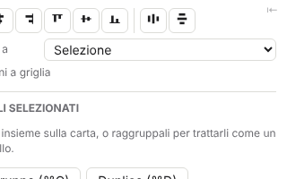

### 4.6 Il retro

**Retro** nella barra dell'editor mostra i livelli del retro, che funzionano come quelli del fronte: possono essere uguali per tutte le carte o prendere valori dal foglio. Nella griglia del set, **Retro** mostra il retro di tutte le carte.

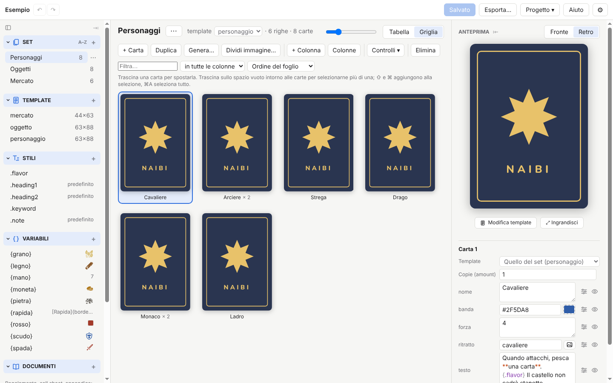

### 4.7 Template derivati

Un template derivato parte da un altro, il base, e ne cambia solo alcune parti: per esempio `carta-fuoco` deriva da `carta` e cambia lo sfondo e il colore della banda. Tutto ciò che il derivato non cambia segue il base, anche quando il base cambia dopo.

Il pulsante ↳ accanto a un template, nella barra laterale, crea un derivato, che si apre nell'editor uguale al base. In intestazione l'editor mostra da quale template deriva, con un link per aprirlo.

Si lavora come su un template normale, con alcune differenze:

- Nel pannello delle proprietà, accanto a ogni valore, la catena indica che viene dal base; la freccia indica che il derivato l'ha cambiato, e un clic sulla freccia torna al valore del base.
- Nel pannello dei livelli, la catena segna i livelli del base, la freccia quelli con modifiche (un clic li riporta come nel base), il + quelli che esistono solo nel derivato.
- I livelli del base non si eliminano (Canc li nasconde), non si spostano nell'elenco e non si rinominano: il loro nome è anche la colonna del foglio, uguale a quella del base. I livelli aggiunti si gestiscono come sempre.
- Le misure della carta sono quelle del base.

**Rendi indipendente**, nell'intestazione, trasforma il derivato in un template normale con i valori che ha in quel momento. Un template che fa da base a un altro non si può eliminare finché i suoi derivati non sono indipendenti o eliminati.

## 5. Inserire e modificare le carte

### 5.1 Creare un set

Il + accanto a **Set** chiede il nome, il template e il foglio: un foglio nuovo, con le colonne che il template legge, o uno già presente nel file dei dati e non ancora collegato.

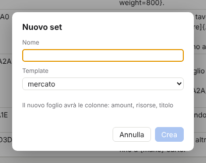

Il foglio può essere anche uno già usato da un altro set: i due set condividono le righe e ognuno le disegna col suo template, per esempio "Truppe rosse" e "Truppe gialle" dallo stesso foglio "Truppe". Una modifica ai dati fatta in uno dei due vale per tutti i set del foglio. Il nuovo set deve avere un nome diverso dal foglio. Rinominare un set con il foglio condiviso non rinomina il foglio, ed eliminarlo lascia il foglio nel file finché lo usa un altro set.

### 5.2 Tabella e griglia

Un set si apre nella **griglia**, con le carte disegnate; **Tabella** lo mostra come foglio di calcolo.

La **tabella** funziona come un foglio di calcolo: doppio clic o digitazione per modificare una cella, Alt+Invio per andare a capo dentro la cella, trascinamento del numero di riga per spostare una carta. **+ Carta**, **Duplica** ed **Elimina** agiscono sulle righe selezionate (Maiuscolo o ⌘ per selezionarne più di una, anche nella griglia). Con più carte selezionate il modulo a destra le modifica in blocco: ciò che si scrive in un campo va in tutte, mentre i campi con valori diversi restano vuoti e non cambiano finché non li si tocca.

La colonna `amount` indica quante copie stampare di ogni carta; vuota vale 1.

Tabella e modulo mostrano tutte le colonne che si possono modificare: quelle del foglio e quelle che il template legge ma il foglio non ha ancora (con l'intestazione in corsivo), che si creano scrivendoci un valore. Il pulsante **Colonne** sceglie quali nascondere; **Ripristina** torna alla vista di base, con le sole colonne lette dai livelli collegati a una colonna (le colonne rimaste nel foglio senza un livello, per esempio da un progetto TTC importato, si nascondono) e i dettagli dei campi chiusi. Nel modulo della carta l'occhio accanto al campo di un livello lo mostra o lo nasconde su quella carta. L'icona con i cursori apre le proprietà del livello per la carta (colore, corsivo, forma, posizione...), con menu per i valori prestabiliti, campi numerici e selettore del colore: un valore scritto lì vale solo per quella carta e crea la colonna `livello.proprietà`, mentre un campo vuoto mostra in grigio il valore del template. Il numero sull'icona dice quante proprietà la carta cambia. Le colonne dei livelli fissi o con formula non arrivano alla carta e restano nascoste; **Mostra i livelli fissi e con formula** le aggiunge in sola lettura, con il simbolo ƒ e il valore che hanno su ogni carta.

Le colonne vero/falso (le proprietà come `stemma.visible` o `nome.italic`, e le colonne in cui ogni cella vale `true` o `false`) hanno una casella: un clic, o la barra spaziatrice sulla cella, la spunta o la toglie. Una casella chiara vuol dire cella vuota: vale il valore del template.

La **griglia** mostra le carte come verranno stampate. Il cursore in alto cambia la dimensione delle miniature (anche con ⌘ e la rotella del mouse); trascinando una carta se ne cambia la posizione.

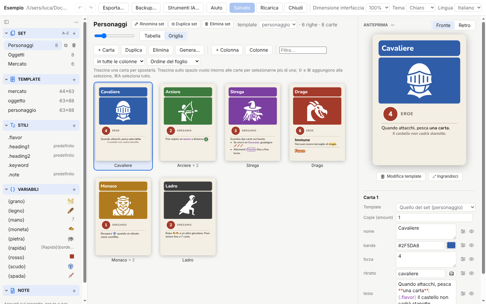

Per selezionare più carte nella griglia si trascina sullo spazio vuoto intorno alle carte: il rettangolo seleziona quelle che tocca, e con Maiuscolo o ⌘ le aggiunge a quelle già selezionate. ⌘A seleziona tutte le carte mostrate (anche con un filtro attivo, solo quelle che passano il filtro), Esc torna alla sola carta in anteprima. Sopra la griglia una barra dice quante carte sono selezionate, con **Seleziona tutte** e **Tieni solo una**. Trascinando una delle carte selezionate si spostano tutte insieme.

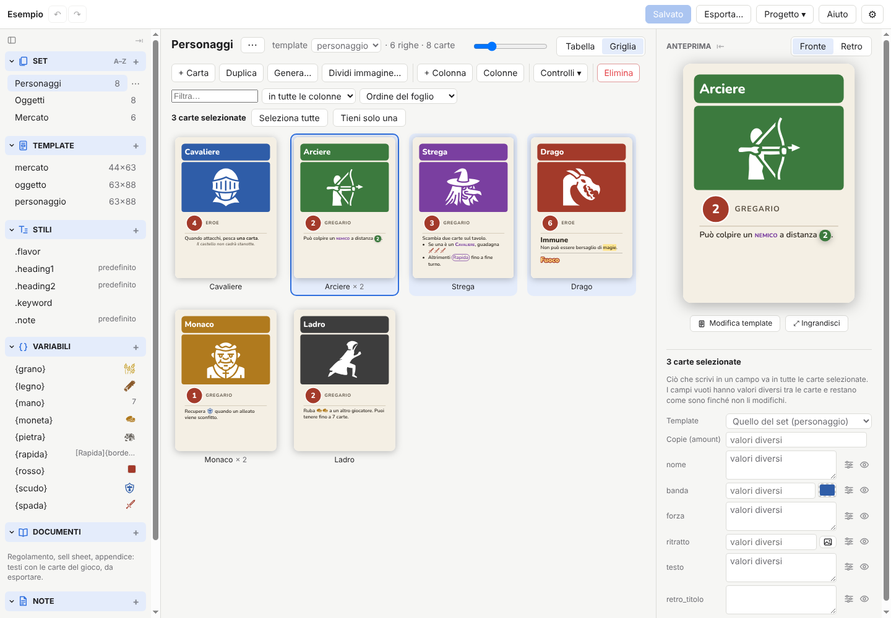

In entrambe le viste, a destra, il modulo della carta selezionata ha un campo per ogni colonna. Un clic su un livello dell'anteprima porta al suo campo; Alt+clic nello stesso punto passa al livello sotto, utile quando un livello ne copre un altro. Il doppio clic modifica il livello direttamente sulla carta: per un testo si apre un riquadro sopra il livello, per un'immagine le miniature, per una forma il selettore del colore. Esc annulla la modifica, un clic fuori o Ctrl+Invio la chiude. Il doppio clic su un livello fisso o con formula dice da dove arriva il valore, con un pulsante per aprire il template. Il pulsante ⤢ in alto nell'anteprima apre la carta grande in una finestra, con il modulo della carta accanto, gli stessi clic e le frecce per passare da una carta all'altra. PagSu e PagGiù passano alla carta precedente o successiva, anche mentre si scrive in un campo del modulo, che resta lo stesso.

### 5.3 Ordinare e filtrare

Un clic sull'intestazione di una colonna ordina le carte (crescente, poi decrescente, poi l'ordine del foglio); nella griglia la colonna si sceglie dal menu. Il campo **Filtra…** mostra solo le righe che contengono un testo, in tutte le colonne o in una sola.

Ordinamento e filtro cambiano solo la vista: il foglio e l'esportazione restano come sono. **Applica questo ordine** riordina il foglio come lo si vede; **Mostra tutto** toglie ordinamento e filtro.

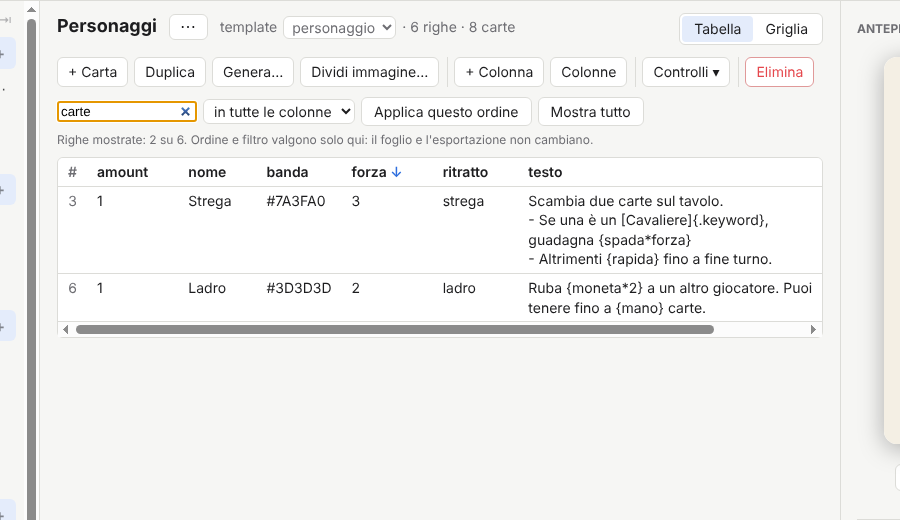

**Statistiche…** mostra quante carte hanno ogni valore di una colonna, anche di un livello con formula, con una barra per confrontarli: serve a bilanciare il set (per esempio quante carte per costo). Per le colonne di numeri dà anche somma, media, minimo e massimo. Le copie della colonna `amount` contano, a meno di togliere la spunta; con un filtro attivo contano solo le carte filtrate.

**Controlla testi…** cerca, in tutte le carte del set, fronte e retro, i testi che non stanno nel loro riquadro: quelli che escono, quelli tagliati e quelli che anche ridotti alla dimensione minima non ci stanno. L'elenco dice carta, faccia e livelli; un clic seleziona la carta. Nella griglia le carte con un testo che non sta hanno un segno arancione accanto al nome.

**Confronta…** segna le carte nuove o cambiate rispetto all'ultima esportazione o a un backup, per ristampare solo quelle. Si sceglie la versione, e nei set le carte diverse hanno un punto blu; **Mostra solo queste** nasconde le altre. Con il confronto attivo, la finestra **Esporta…** propone **Solo le carte nuove o cambiate**. Il confronto guarda quello che le carte mostrano (dati, template, variabili e stili che usano), non il contenuto dei file di immagini e font; una carta spostata non conta come cambiata, a meno che mostri il suo numero. Ogni esportazione fatta dall'app ricorda le carte esportate nel file nascosto `.naibi-printed.json` del progetto.

### 5.4 Colonne delle proprietà

Oltre al valore principale, ogni proprietà di un livello può cambiare carta per carta con una colonna `livello.proprietà`: per esempio `nome.color` per il colore del titolo o `icona.tint` per la colorazione di un'icona. **+ Colonna** propone le colonne che il template legge e che mancano nel foglio, le proprietà di un livello a scelta, o una colonna libera.

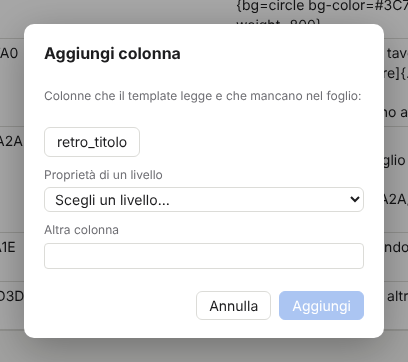

Nelle celle i colori si scrivono come nomi (`red`, o il nome di una variabile colore) o in esadecimale (`#A33A2A`); un contorno come `colore/spessore/tratteggio`, per esempio `red/0.3/dashed`; un ritaglio come `x y larghezza altezza` in percentuale dell'immagine, per esempio `10 0 50 50` (`none` per l'immagine intera). Nel modulo della carta il pulsante **Ritaglia…** accanto al campo del ritaglio scrive questi numeri al posto tuo.

Il campo **Template**, in cima al modulo della carta, sceglie il template di una singola carta tra quelli con le misure del set: vuoto vale quello del set, e la scelta va nella colonna `template` del foglio. Serve per esempio per dare a poche carte di un set un template derivato. Nel modulo della carta il campo diventa un menu con i template che hanno le stesse misure di quello del set.

### 5.5 Modificare il file in Excel

Il file dei dati è un normale foglio di calcolo e si può modificare anche con Excel, LibreOffice o Numbers, anche con il progetto aperto: quando salvi il file, Naibi lo rilegge da solo. Se in Naibi ci sono modifiche ai dati non ancora salvate, invece, compare un avviso con **Ricarica** e **Ignora**. Per modificare i dati solo fuori da Naibi, spunta **in sola lettura** accanto al nome del file, in fondo alla barra laterale, e salva: Naibi non scrive più nel file dei dati, le modifiche ai dati nella griglia e nella scheda della carta vengono rifiutate e accanto al conteggio delle carte compare _sola lettura_. Template, anteprime ed esportazioni funzionano come sempre. **Controlla file dati…**, sotto la casella, mostra come Naibi legge ogni foglio: i set che lo usano, le colonne che i loro template leggono e il foglio non ha, e le anomalie (titoli sopra le intestazioni, celle unite, errori di Excel, formule senza risultato salvato, righe vuote); non modifica il file. Dalla stessa finestra, **Importa un foglio da un altro file…** mette le righe di un foglio di un altro file (.xlsx, .ods, .csv) al posto di quelle di un set: prima mostra le righe nuove, tolte e cambiate (riconosciute da una colonna con valori tutti diversi, come il nome) e permette di tenere le colonne che il file non ha; poi fa un backup del progetto. La modifica si annulla con ⌘Z. Al salvataggio Naibi riscrive solo le colonne con un'intestazione: formattazione delle celle, altri fogli e colonne senza intestazione restano come sono. Una cella con una formula di Excel resta una formula finché il risultato non cambia. Se parti da un file Excel che hai già, con formule e fogli di analisi, leggi [Usare un file Excel che hai già](excel-esistente.md).

### 5.6 Dati da Google Sheets

Se tieni i dati in un foglio Google, **Google Sheets…** nella barra in alto li porta nel progetto. Nel foglio Google scegli **Condividi** → **Chiunque abbia il link** (lettore), copia il link e incollalo; **Scarica** legge tutte le schede. Ogni scheda va al set con lo stesso nome (senza badare a maiuscole); dal menu puoi sceglierne un altro o **non importare** la scheda. Se una scheda non ha alcune colonne del set, la finestra le elenca: dopo l'importazione quelle colonne non ci sono più. **Importa** sostituisce i dati dei set scelti (⌘Z annulla) e **Salva** li scrive nel file dei dati del progetto, che resta la copia locale: Naibi funziona anche senza rete.

Il link resta nel progetto: la volta dopo basta aprire la finestra e premere **Scarica**. Un foglio non condiviso con il link non si può scaricare, e Naibi lo dice. Un'IA può fare lo stesso con `naibi pull-sheets`.

## 6. Testo e markup

Il testo delle carte si scrive con un markup semplice, uguale nell'app e nelle celle del foglio. Non serve HTML.

### 6.1 Markdown

| Scrivi                       | Ottieni                                        |
| ---------------------------- | ---------------------------------------------- |
| `**testo**`                  | grassetto                                      |
| `*testo*`                    | corsivo                                        |
| `++testo++`                  | sottolineato                                   |
| `~~testo~~`                  | barrato                                        |
| `==testo==`                  | evidenziato                                    |
| `^testo^` / `~testo~`        | apice / pedice                                 |
| `# Titolo`, `## Sottotitolo` | paragrafo con lo stile `heading1` o `heading2` |
| `> testo`                    | paragrafo con lo stile `note`                  |
| `- voce` / `1. voce`         | elenco puntato / numerato                      |
| `---`                        | linea separatrice                              |
| `\` a fine riga              | a capo senza nuovo paragrafo                   |
| `_4{moneta}_`                | non va mai a capo                              |

Ogni a capo inizia un nuovo paragrafo, come quando si scrive in una cella di Excel con Alt+Invio. Per tenere un pezzo di testo sulla stessa riga, così che `4` e la sua icona non finiscano su righe diverse, lo si chiude tra due trattini bassi: `_4{moneta}_`. È lo stesso di `[4{moneta}]{nowrap}`. Un trattino basso dentro una parola (`nome_file`) resta com'è; per scriverne uno isolato si usa `\_`.

### 6.2 Attributi

Le parentesi quadre delimitano il testo e le graffe che seguono dicono come formattarlo: `[Attenzione]{color=red weight=800}`. Gli attributi si separano con spazi.

| Attributo                             | Esempio                                    | Effetto                                        |
| ------------------------------------- | ------------------------------------------ | ---------------------------------------------- |
| `.nome`                               | `[pino]{.keyword}`                         | applica uno stile                              |
| `color=`, `highlight=`                | `{color=#A33A2A}`                          | colore del testo o dell'evidenziazione         |
| `size=`                               | `{size=14}` · `{size=+2}` · `{size=80%}`   | dimensione in pt, relativa o in percentuale    |
| `font=`, `weight=`                    | `{font=Open_Sans weight=800}`              | famiglia (con `_` al posto degli spazi) e peso |
| `stroke=`                             | `{stroke=white/8%}`                        | contorno delle lettere                         |
| `upper`, `lower`, `smallcaps`         | `[Fase]{smallcaps}`                        | maiuscole, minuscole, maiuscoletto             |
| `nowrap`                              | `[4 monete]{nowrap}`                       | la porzione non va a capo                      |
| `left`, `center`, `right`, `justify`  | `{.flavor center}` a inizio paragrafo      | allineamento del paragrafo                     |
| `border=`, `fill=`, `radius=`, `pad=` | `[Rapida]{border=red/0.3 radius=round}`    | riquadro attorno al testo                      |
| `bg=`, `bg-color=`, `bg-size=`        | `[3]{bg=circle bg-color=blue color=white}` | forma o immagine dietro il testo               |

Le forme `circle`, `square`, `rounded`, `hexagon` e `diamond` sono sempre disponibili per `bg=`. Per alzare o abbassare il testo dentro il riquadro senza spostare il riquadro si usa `text-raise=` in pt, anche in uno stile: `.cuore = bg=cuore color=white text-raise=1` (`raise=` invece sposta tutto il riquadro).

### 6.3 Campi, variabili e icone

| Scrivi                        | Ottieni                                                         |
| ----------------------------- | --------------------------------------------------------------- |
| `{forza}`                     | il valore del campo `forza` della carta                         |
| `{spada}`                     | la variabile `spada`: un'icona, un testo, un colore o un valore |
| `{spada*3}` · `{spada*forza}` | l'icona ripetuta tre volte, o tante volte quanto vale il campo  |
| `{legno}`                     | un'immagine di `assets/` con quel nome, alta quanto la riga     |
| `{spada tint=red size=150%}`  | l'icona con attributi validi solo per questo uso                |
| `\{`, `\*`, `\[`              | il carattere letterale                                          |

Naibi conosce da sé alcuni valori, le **variabili di sistema**, che si scrivono come i campi, anche nelle formule: `{project.name}` (il gioco), `{set.name}`, `{template.name}`, `{card.number}` (la riga della carta nel set), `{set.rows}`, `{set.cards}` (le carte con le copie), `{card.copies}`, `{card.copy}` (la copia stampata, per scrivere per esempio `{card.copy}/{card.copies}`), `{card.side}` (`front` o `back`) e `{date}`. Un piè di pagina come `{set.name} {card.number}/{set.rows}` numera le carte da solo.

Il pulsante **Aiuto** nella barra in alto e nella schermata di ingresso, o il tasto F1, apre un riepilogo del markup, dei campi e delle variabili, delle variabili di sistema, delle formule e delle scorciatoie.

<table><tr>
<td width="50%">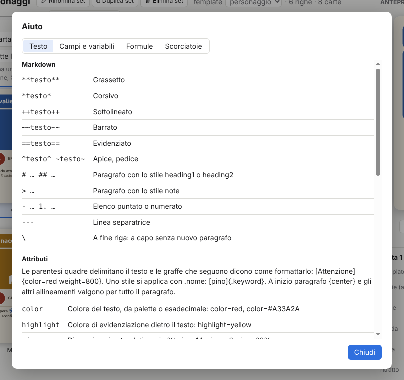</td>
<td width="50%">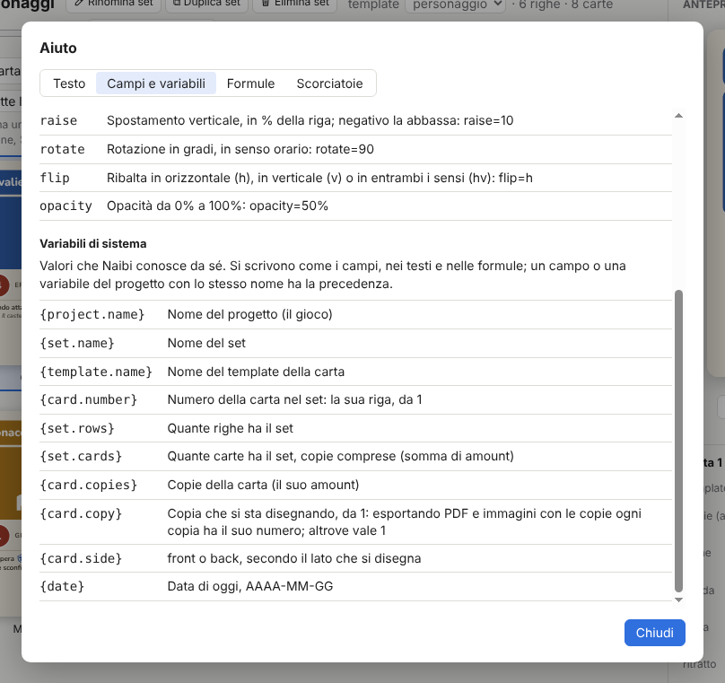</td>
</tr></table>

### 6.4 Aiuto alla scrittura

Nei campi di testo dell'editor, del modulo della carta e nelle celle della tabella, digitando `{` compaiono i campi e le variabili, con l'anteprima dell'icona, del testo o del colore. ↑ e ↓ scelgono, Invio o Tab inseriscono, Esc chiude. Dentro le graffe compaiono allo stesso modo gli attributi, gli stili e i colori.

Il markup è colorato mentre si scrive. Gli errori, come una variabile che non esiste, sono sottolineati in rosso e compaiono sotto l'anteprima nella sezione **Problemi su questa carta**.

<table>
<tr>
<td width="50%">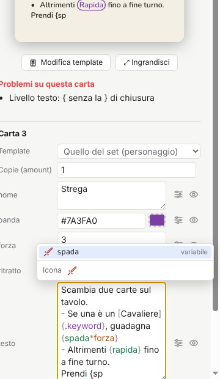</td>
<td width="50%">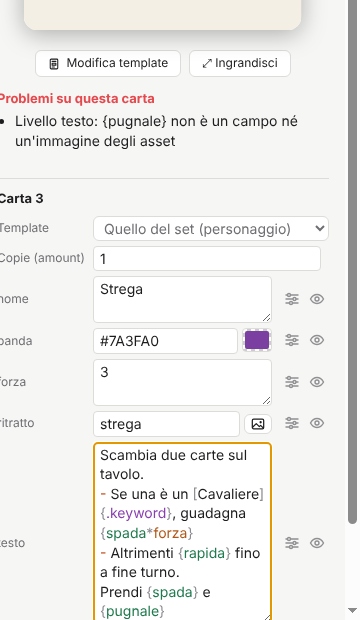</td>
</tr>
</table>

### 6.5 Formattare senza scrivere il markup

Il pulsante **Aa Formatta…** sotto un campo di testo apre l'editor visuale: si seleziona una parte del testo, si scelgono gli attributi e l'app scrive `[testo]{...}`. In fondo si vede il markup risultante. **Salva come stile…** trasforma la formattazione in uno stile del progetto; **Togli la formattazione** rimuove le parentesi. Accanto a **Sfondo** un pulsante apre le miniature: forme predefinite, variabili immagine e immagini del progetto.

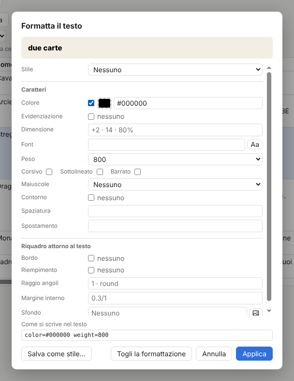

## 7. Variabili e stili

### 7.1 Variabili

Le variabili si creano con il + accanto a **Variabili** e si modificano con un clic. Ce ne sono quattro tipi:

- **Icona**: un'immagine di `assets/` con tinta, dimensione rispetto alla riga, spostamento verticale, rotazione, ribaltamento e opacità. Con **Colore del testo in cui è inserita** l'icona prende il colore del testo.
- **Testo**: un testo, anche formattato, che sostituisce `{nome}`. Può richiamare altre variabili.
- **Colore**: un colore con un nome, utilizzabile in ogni proprietà colore e negli attributi del markup. Una variabile con il nome di un colore predefinito (per esempio `red`) lo ridefinisce in tutto il progetto.
- **Valore**: un testo o un numero, utilizzabile nei testi e nelle formule (per esempio il numero massimo di carte in mano).

<table>
<tr>
<td width="50%">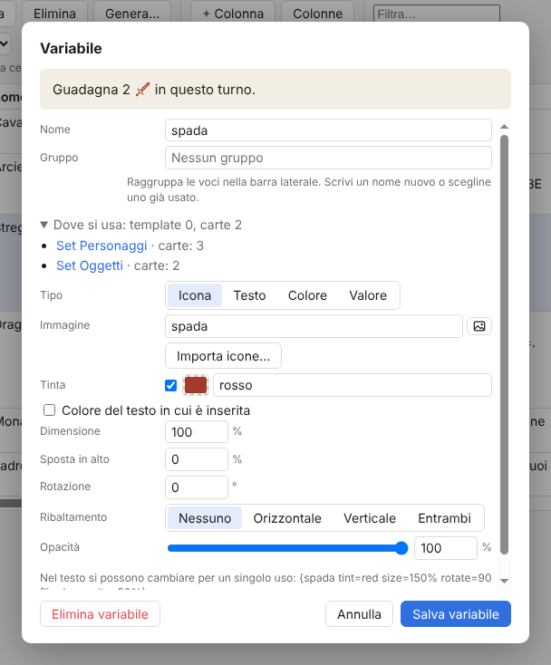</td>
<td width="50%">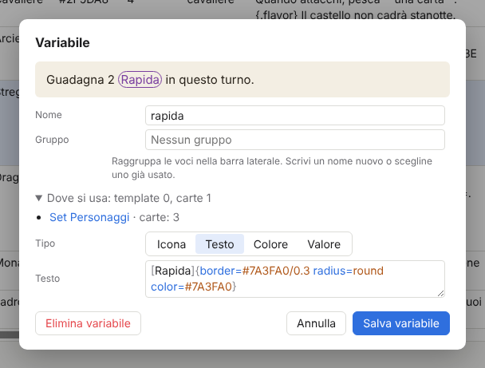</td>
</tr>
</table>

In cima alla finestra una frase di prova mostra il risultato. Rinominare una variabile aggiorna i richiami nei template, nelle celle, nelle altre variabili e negli stili.

### 7.2 Stili di testo

Uno stile raccoglie attributi del testo con un nome: si applica a un livello intero (proprietà **Stile**), a un paragrafo (`{.nome}` a inizio riga) o a una porzione (`[testo]{.nome}`). Modificando lo stile cambiano tutte le carte che lo usano. Uno stile può basarsi su un altro ed ereditarne gli attributi.

`heading1`, `heading2` e `note` esistono in ogni progetto e corrispondono a `#`, `##` e `>`; si possono ridefinire.

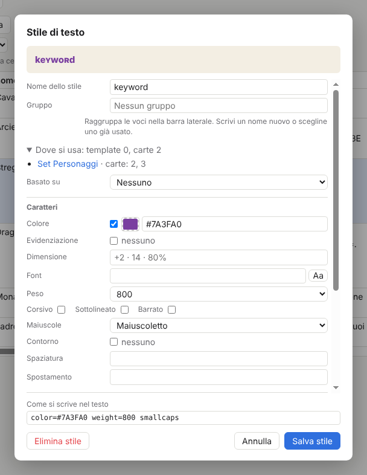

### 7.3 Scegliere un colore

Il quadratino accanto a ogni campo colore apre il selettore: l'area grande sceglie saturazione e luminosità, le due barre sotto la tonalità e la trasparenza. Il codice esadecimale si scrive nel campo accanto all'anteprima; **RGB** e **HSL** cambiano i tre campi numerici (le frecce su e giù li cambiano di 1, con Maiuscolo di 10). Il contagocce prende un colore da qualunque punto dello schermo, anche da un'altra finestra. Sotto ci sono i colori del progetto (le variabili colore, che si scrivono per nome) e gli ultimi colori scelti, comuni a tutti i progetti. Esc o un clic fuori chiudono il selettore.

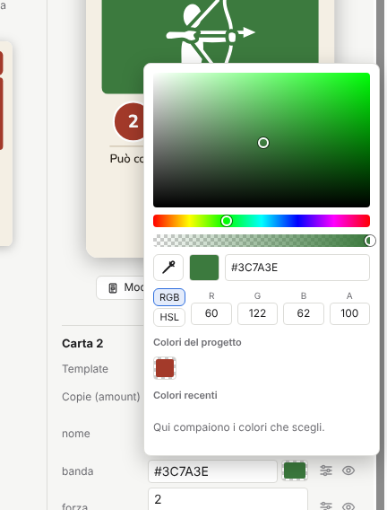

## 8. Immagini, icone e font

### 8.1 Immagini del progetto

Le immagini stanno in `assets/`, anche in sottocartelle, nei formati SVG, PNG, WebP e JPG. Ovunque si indichi un'immagine basta il nome del file, senza cartella né estensione. Se due file hanno lo stesso nome (per esempio `spada.png` e `spada.svg`) l'app lo segnala e chiede di aggiungere l'estensione o la cartella.

Il pulsante con l'immagine accanto ai campi apre le miniature degli asset, con ricerca e filtro per cartella.

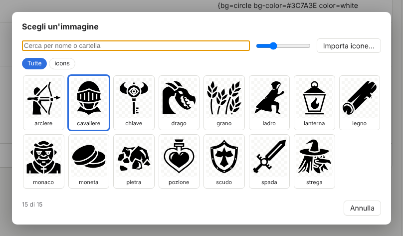

Le icone a un colore (SVG nere su fondo trasparente) si ricolorano con la proprietà **Colorazione** del livello o con la tinta della variabile.

### 8.2 Importare icone

**Importa icone…**, nella scelta delle immagini e nella finestra di una variabile icona, apre tre raccolte incluse nell'app, che funzionano senza rete, e una online:

- **game-icons.net**: circa 4200 icone, con categorie tradotte e ricerca anche in italiano. Licenza CC BY 3.0: gli autori vanno citati (vedi i crediti, [capitolo 11.6](#116-crediti)). **Aggiorna catalogo** scarica le icone pubblicate dopo questa versione dell'app (serve la rete, richiede circa un minuto).
- **Kenney: icone e motivi**: icone per giochi da tavolo e motivi ripetibili, in CC0.
- **Kenney: carte, dadi e pedine**: immagini PNG a colori, in CC0.
- **Iconify (online)**: oltre 200 altre collezioni (Material Design, Tabler, Phosphor, emoji...), cercate su internet. Si scrive nella ricerca per cercare in tutte, oppure si sceglie una collezione a sinistra per sfogliarla. I nomi delle icone sono in inglese.

Si possono scegliere più icone, anche da raccolte diverse, e rinominarle prima di importarle. Le icone finiscono in `assets/icons/` (quelle a colori in `assets/images/`) e la loro provenienza in `assets/sources.json`.

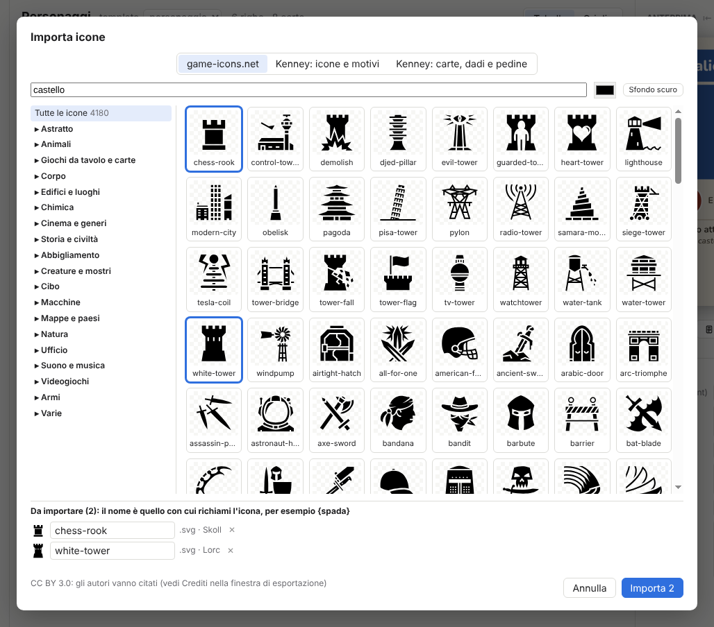

Ogni collezione di Iconify ha la sua licenza, indicata da un pallino: verde per le licenze libere, blu per quelle che chiedono di citare l'autore, arancione per quelle restrittive per un gioco pubblicato (condivisione allo stesso modo, uso non commerciale, GPL). **Nascondi le licenze restrittive** le toglie dall'elenco e dai risultati. La licenza e l'autore della collezione finiscono nei crediti come per le altre icone.

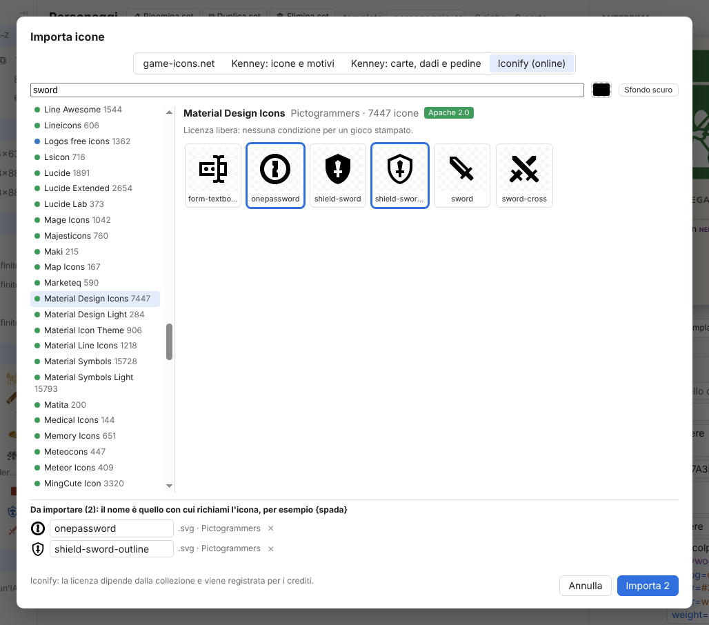

### 8.3 Font

Il pulsante **Aa** accanto al campo del font apre la scelta dei font, con tre schede:

- **Nel progetto**: i font in `assets/fonts/` e Nunito, il font incluso nell'app.
- **Google Fonts**: il catalogo di Google Fonts, con filtro per categoria. Si scelgono gli stili e **Scarica** salva i file in `assets/fonts/`, con la licenza. Le anteprime richiedono la rete; dopo il download il font funziona anche senza. **Aggiorna catalogo** scarica l'elenco più recente, con i font pubblicati dopo questa versione dell'app.
- **Sul computer**: i font installati. **Copia nel progetto** copia i file in `assets/fonts/`, se la licenza lo permette; altrimenti il progetto si vede uguale solo dove quel font è installato.

<table>
<tr>
<td width="50%">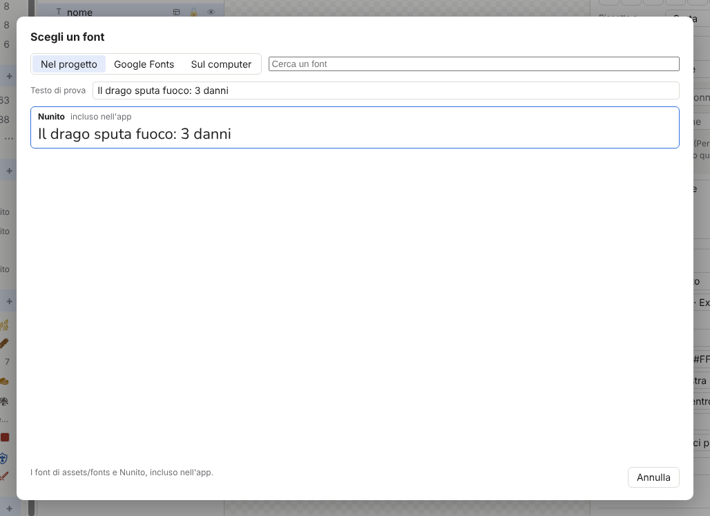</td>
<td width="50%">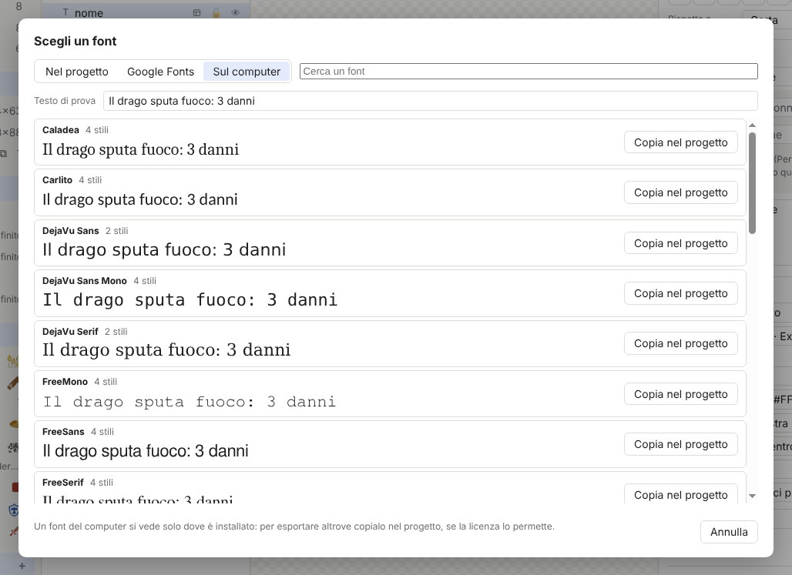</td>
</tr>
</table>

Un font che non si trova viene segnalato sotto la carta e al termine dell'esportazione; il testo usa intanto un font predefinito. Al posto del nome del font si può scrivere una variabile di testo, per esempio `{titoli}`: cambiando la variabile cambia il font di tutti i livelli che la usano.

## 9. Formule e campi calcolati

Un livello con **Valore sulle carte: Formula** calcola il proprio valore dagli altri campi della carta.

- **Composizione di testo**: `{nome}.png`, `Forza {forza}`.
- **Calcolo**: se la formula contiene `+ - * /` e il risultato è un numero, si calcola: `{forza}+2`.
- **Espressione**: con `=` iniziale funziona come in Excel. Testi tra virgolette, confronti `= <> < > <= >=`, `&` per unire testi, argomenti separati da `;` o `,`. Funzioni: `IF`, `AND`, `OR`, `NOT`, `MIN`, `MAX`, `ABS`, `ROUND`, `FLOOR`, `CEILING`, `UPPER`, `LOWER`, `LEN`, `CONCAT`, `ISBLANK`, `COUNTIN`.

Nell'esempio il livello `rango` mostra "Eroe" o "Gregario" secondo la forza. Sotto la formula compare il risultato per la prima carta del set.

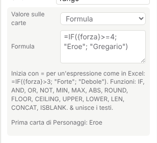

Il livello **Valore** (strumento #) non si disegna: contiene un valore della carta da usare nelle formule e nei testi degli altri livelli come `{nome}`. Nell'esempio, il livello `punti` delle carte mercato conta le risorse con `COUNTIN` e il livello `punti_testo` lo mostra.

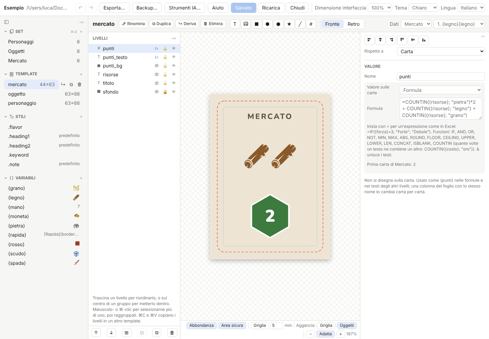

Un livello valore può dare anche un colore: nei campi colore (riempimento, colore del testo, contorno, ombra, tinta) si scrive `{nome}` del livello, che il menu del campo propone. Il valore calcolato può essere un codice come `#A33A2A`, un nome di colore o una variabile colore, per esempio `=IF({forza}>3; "rosso"; "blu")`. Se il valore è vuoto il colore è trasparente.

Un campo vale, in ordine di precedenza: il livello valore calcolato, la cella non vuota della riga, il valore scritto nel template. Gli errori delle formule compaiono sotto la carta e nel pannello delle proprietà.

## 10. Generare le carte

**Genera…**, nell'intestazione del set, crea le righe combinando insiemi di valori. Ogni insieme ha una colonna di destinazione, un elenco di valori (uno per riga o separati da virgole; `1-5` diventa 1, 2, 3, 4, 5) e quanti valori mettere su ogni carta.

- Più insiemi si combinano in tutti i modi possibili: 6 semi e i numeri 1-5 danno 30 carte.
- Con più valori per carta si sceglie se ammettere le ripetizioni e se conta l'ordine. In **Limiti per valore** si fissano minimo e massimo per ciascun valore.
- **Come icona** scrive ogni valore come `{valore}`, così il testo mostra l'icona con quel nome.
- **Filtro** tiene solo le carte per cui un'espressione è vera, per esempio `COUNTIN({costo}; "oro") <= 1`.

L'anteprima mostra quante carte nasceranno e le prime righe. **Aggiungi in fondo** accoda le carte, **Sostituisci le carte** prende il posto di quelle esistenti. **Aggiorna le carte** scrive solo le colonne generate nelle carte già presenti, una per riga, lasciando le altre colonne come sono: per esempio si generano prima 30 carte da 6 semi e i numeri 1-5, poi con **Da una cartella…** si assegnano 30 ritratti alla colonna del ritratto. Se le carte generate sono di più, quelle in più si aggiungono in fondo. ⌘Z annulla.

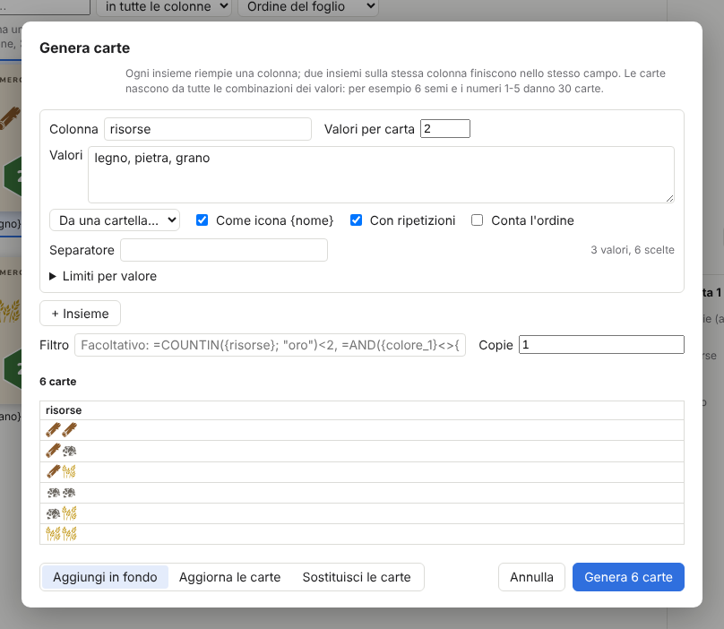

### 10.1 Dividere un'immagine tra le carte

**Dividi immagine…** distribuisce un'immagine grande tra le carte del set: messe in griglia una accanto all'altra, le carte la ricompongono (una mappa, un'illustrazione su più carte). Si scelgono il livello immagine del template, l'immagine, quante colonne e righe, da quale carta cominciare e l'ordine: per righe (da sinistra a destra, poi la riga sotto) o per colonne. Se mancano carte se ne aggiungono.

Ogni carta mostra la parte dell'immagine che sta sotto il suo livello, come se l'immagine coprisse tutta la griglia delle carte rifilate. Naibi scrive nelle colonne della carta l'immagine (`livello.src`), il ritaglio (`livello.crop`) e l'adattamento **Allunga**; toglie la tinta, così un'icona del template non diventa una sagoma. L'abbondanza delle carte interne prende l'immagine delle carte vicine. Per le carte sul bordo ci sono due possibilità: se l'immagine comprende anche l'abbondanza intorno a tutta la griglia (casella apposita), la usa; altrimenti il livello si ferma al bordo dell'immagine e nell'abbondanza esterna si vede quello che c'è sotto. Le proporzioni giuste dell'immagine sono colonne × larghezza della carta per righe × altezza (più l'abbondanza, se compresa): se l'immagine è diversa la finestra lo dice, perché i pezzi risulterebbero un po' deformati. Si possono dividere i livelli immagine non ruotati e fuori dai gruppi.

## 11. Esportare

**Esporta…** apre una finestra con tre schede: immagini, PDF e Tabletop Simulator. In ogni scheda si scelgono i set e se ripetere le carte secondo la colonna `amount`. Le carte si disegnano con lo stesso motore dell'anteprima, comprese le modifiche non ancora salvate.

### 11.1 Immagini

Formato PNG, JPG, WebP o SVG, risoluzione (150, 300, 600 DPI o personalizzata), abbondanza inclusa o no, fronte, retro o entrambi, sfondo trasparente fuori dagli angoli arrotondati. I nomi dei file seguono un modello con `%set`, `%n` (numero della carta), `%copy`, `%side` e `{campo}`; una `/` crea sottocartelle.

L'SVG è vettoriale e non ha una risoluzione: si ingrandisce senza perdere qualità e si apre nei programmi di grafica (Inkscape, Illustrator, Affinity). Immagini e font del progetto sono dentro il file; i font installati sul computer no, e chi apre il file deve averli. I testi diventano testi SVG, una riga per elemento, quindi si modificano ma non vanno più a capo da soli.

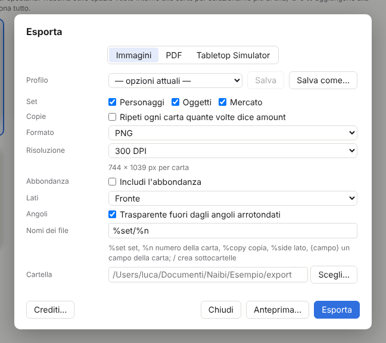

### 11.2 PDF di stampa

Il PDF è vettoriale, con i font incorporati. Si scelgono pagina e orientamento, margini, spaziatura e disposizione (quante carte ci stanno, o righe × colonne). Le altre opzioni:

- **Abbondanza**: con l'abbondanza le carte si toccano e i segni di taglio sono all'esterno.
- **Rotazione**: ruota le carte se altrimenti non entrano o ne entrano di più.
- **Poster**: divide su più pagine le carte più grandi della pagina, con una sovrapposizione.
- **Piegatura**: fronte e retro affiancati, da piegare.
- **Segni di taglio**: agli angoli o a linee intere, con lunghezza, spessore e colore.
- **Fronte-retro**: retri su pagine alternate, girando il foglio sul lato lungo o corto, con una correzione dello spostamento per le stampanti che non allineano i due lati.
- **Pagine**: con **Uno dopo l'altro sulla stessa pagina** un set comincia subito dopo il precedente invece che su una pagina nuova (10 + 8 carte con 9 per pagina stanno in 2 pagine invece di 3). Un set con carte di un'altra misura comincia su una riga nuova, se nella pagina c'è posto.
- **Foglio di prova**: un PDF a parte con tutte le carte in piccolo.
- **Converti in CMYK**: richiede Ghostscript installato sul computer.

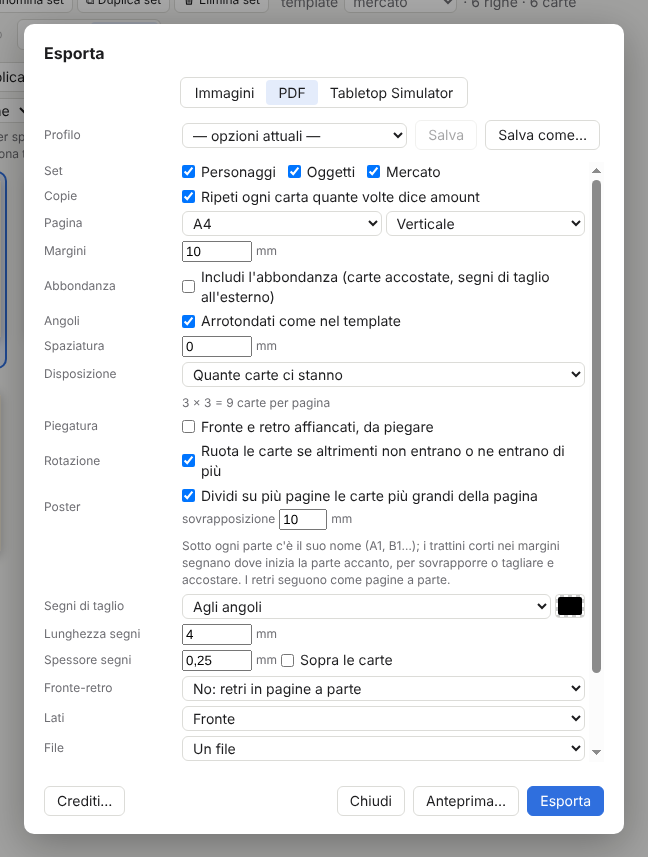

### 11.3 Anteprima

**Anteprima…** mostra i file che l'esportazione scriverà, senza scrivere nulla: le immagini con il nome del file, le pagine del PDF, i fogli di Tabletop Simulator. Si scorrono con ‹ › o con le frecce.

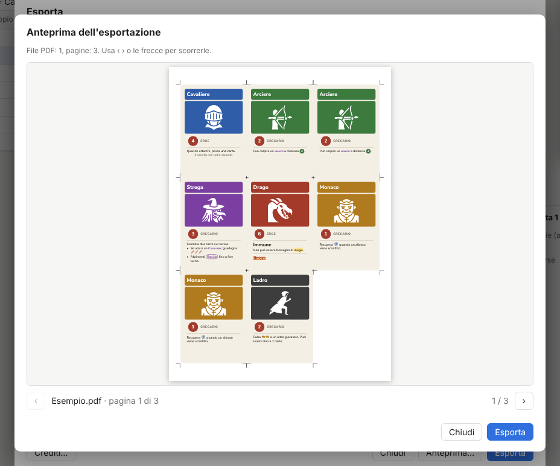

### 11.4 Tabletop Simulator

Crea per ogni set i fogli di carte (fino a 10 × 7, con la griglia scelta in automatico per ridurre gli spazi vuoti) e il file del mazzo da caricare in Tabletop Simulator. I file vanno nella cartella del progetto, in quella degli oggetti salvati di Tabletop Simulator o in entrambe. Nickname e descrizione delle carte possono venire da un campo.

Con **Copie** attivo, **Copie nel foglio** decide dove finiscono le copie di una carta: una volta sola nel foglio, e il file del mazzo la moltiplica (è la scelta predefinita e tiene i fogli piccoli), oppure ripetute nel foglio quante volte dice `amount`. La seconda serve quando si caricano i fogli a mano in Tabletop Simulator, senza il file del mazzo: ogni posizione del foglio è una carta.

**Oggetti** sceglie per ogni set cosa creare in Tabletop Simulator:

- **Carte**: il mazzo dai fogli, come sopra.
- **Segnalini**: un'immagine per carta, ritagliata sulla forma della carta (rettangolo, angoli arrotondati, cerchio, esagono o sagoma). Tabletop Simulator ne fa un pezzo spesso con il bordo del colore dell'immagine; sotto mostra il fronte specchiato, quindi il retro della carta non si usa.
- **Tessere**: fronte e retro della carta. La forma (quadrata, arrotondata, esagonale o rotonda) viene dalla forma della carta; una sagoma diventa un quadrato. **Bordo** è il colore dello spessore.
- **Plance**: come le tessere (fronte, retro, bordo e spessore), ma non si impilano e non vanno in un sacchetto: ogni plancia, copie comprese, arriva sul tavolo accanto alle altre.
- **Dadi (6 facce)**: ogni sei carte del set fanno un dado, nell'ordine del foglio: la prima carta va sulla faccia 1, la seconda sulla 2 e così via; le facce opposte fanno 7 (1-6, 2-5, 3-4). Se le carte non sono un multiplo di sei, l'ultimo dado ripete le sue prime facce e l'esportazione lo segnala. Le copie del dado sono quelle (`amount`) della sua prima carta. Il valore che Tabletop Simulator mostra quando lo tiri è il campo scelto in **Nome** della carta, oppure il numero della faccia. Usa un template quadrato: la faccia del dado è quadrata, larga quanto la carta, e una carta rettangolare viene schiacciata. Naibi scrive anche il modello del cubo (`models/<set>_d6.obj`) accanto alle immagini.

Per segnalini e tessere **Spessore** è in mm. I pezzi di un set vanno in un sacchetto, copie comprese; un set con un pezzo solo diventa quel pezzo. Carte, segnalini e tessere arrivano in Tabletop Simulator nelle proporzioni vere: una carta da 63 mm ha la misura predefinita di Tabletop Simulator, e tutto il resto è più grande o più piccolo in proporzione.

I fogli si richiamano con indirizzi locali, quindi il mazzo funziona sul computer che l'ha esportato. Per giocare online bisogna caricare le immagini su un servizio web e cambiare gli indirizzi in Tabletop Simulator.

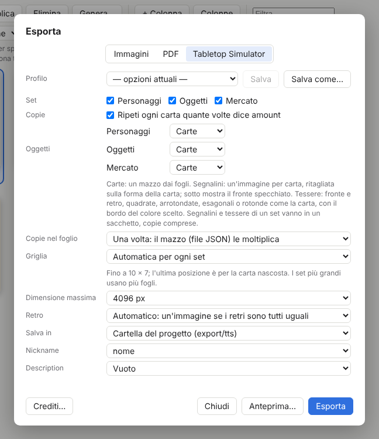

### 11.5 Profili e preset

**Profilo**, in cima alla finestra, sceglie un profilo salvato nel progetto o un preset: MakePlayingCards, The Game Crafter, stampa in casa su A4 o Letter. **Salva come…** salva le opzioni attuali come profilo con un nome, da rilanciare in seguito. Prima di ordinare conviene controllare le specifiche sul sito della tipografia, che possono cambiare.

### 11.6 Crediti

**Crediti…** compone il testo da mettere nel regolamento o sulla scatola, con le icone e i font importati dall'app raggruppati per fonte, licenza e autore. Di base elenca solo ciò che le carte usano. Il testo si copia o si salva in `export/credits.txt`. Le immagini copiate a mano in `assets/` non sono elencate.

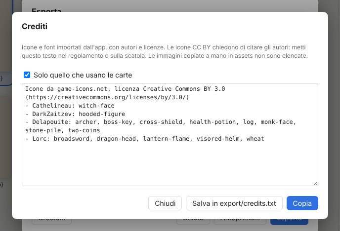

## 12. Documenti

Nella sezione **Documenti** della barra laterale si scrivono i testi che accompagnano il gioco: il regolamento, una sell sheet, un'appendice, le domande frequenti. Il + crea un documento, un clic lo apre al posto del set o del template aperto. A sinistra si scrive, a destra l'anteprima mostra la pagina mentre si scrive e segue il cursore; un clic su un punto dell'anteprima porta il cursore a quel punto del testo. Il nome si cambia dal titolo, il cestino sposta il documento in `deleted`. I documenti si salvano da soli mentre si scrive, come file `docs/<nome>.md` del progetto, e si possono scrivere anche con un altro editor o da un agente IA.

Il testo è Markdown, con il markup di Naibi del [capitolo 6](#6-testo-e-markup) dentro le righe:

| Scrivi                                  | Ottieni                                                             |
| --------------------------------------- | ------------------------------------------------------------------- |
| `# Titolo`, `## Titolo`, `### Titolo`   | titoli di tre livelli                                               |
| una riga vuota                          | un paragrafo nuovo; un a capo semplice resta nello stesso paragrafo |
| `- voce`, `1. voce`                     | elenchi; una voce con due spazi davanti scende di un livello        |
| `> testo`                               | un riquadro per una nota                                            |
| `\| a \| b \|` e sotto `\|---\|---\|`   | una tabella; `:--`, `:-:` e `--:` allineano la colonna              |
| `---`                                   | una linea                                                           |
| `{spada}`, `[testo]{.keyword}`          | icone, variabili e stili, come sulle carte                          |
| `{project.name}`, `{date}`              | il nome del progetto e la data di oggi                              |
| `` | una carta del gioco, con la didascalia "Il mago"                    |
| ``                  | un'immagine degli asset                                             |

Le carte non si copiano nel documento: Naibi le disegna dal progetto, quindi una modifica ai dati o al template si vede subito anche nel documento. **Inserisci carta** apre una finestra in cui si sceglie il set e la carta (si cerca per nome), il lato, la larghezza in millimetri (vuota per la misura vera) e la didascalia, e scrive il riferimento al posto del cursore. A mano si scrive `card:Set/3` per la carta della riga 3 oppure `card:Set/colonna=valore` per la carta che ha quel valore in una colonna; dopo un `?` si aggiungono `side=back` per il retro e `width=40` per la larghezza, unite da `&`, come in `card:Personaggi/nome=Mago?side=back&width=40`. Il valore di una colonna, come il nome, è più sicuro del numero, che cambia se le righe si riordinano. Più immagini sulla stessa riga del testo stanno affiancate.

**Tabella** apre una griglia da compilare: la prima riga è l'intestazione, ogni colonna ha il suo allineamento, **+ Riga** e **+ Colonna** la allargano e × toglie una riga o una colonna. Si possono incollare celle copiate da Excel o da un altro foglio di calcolo. Con il cursore dentro una tabella già scritta, lo stesso tasto la apre per modificarla. Nel testo la tabella diventa Markdown con le colonne allineate.

**Pagina** apre a destra le impostazioni del documento: formato (A4, A5, Letter), margini, carattere del testo e dei titoli, dimensione del testo, interlinea, spazio dopo i paragrafi, allineamento (a sinistra o giustificato) e colore del testo e dei titoli. L'anteprima mostra la pagina alla sua larghezza vera, ridotta se non ci sta. Le impostazioni sono scritte in testa al file, tra due righe `---`, come `size: 12` o `lineHeight: 1.6`: si possono cambiare anche lì, e **Torna ai valori di base** le toglie.

**Esporta** salva il documento in `export/docs/` del progetto in tre forme: **PDF**, da stampare o inviare, con il formato e i margini del documento (solo nell'app per computer); **HTML**, una pagina web in un solo file, con carte, immagini e font dentro; **Markdown**, testo semplice per altri programmi, con le carte in PNG a 300 dpi e le immagini in una cartella accanto (`<nome> images`). Nel Markdown restano grassetto, corsivo e barrato; gli altri stili si perdono. Le carte e le immagini che non si trovano restano fuori, e la finestra lo ricorda se il documento ha dei problemi.

Sotto il testo compaiono i problemi: carte che non si trovano, immagini che non sono negli asset, nomi tra graffe sconosciuti; un clic porta al punto del testo. `naibi check` li segnala insieme a quelli delle carte, e `naibi docs` mostra i documenti a un agente IA. Per ora i documenti si leggono solo nell'app: l'esportazione in PDF, HTML e Markdown con le immagini arriverà con una prossima versione.

## 13. Backup

**Backup…** apre i backup del progetto. Di base l'app crea un backup automatico all'apertura del progetto (al massimo uno all'ora) e ne tiene gli ultimi 10; quelli fatti con **Crea un backup ora** non si cancellano da soli.

I backup stanno fuori dal progetto, di base in `Documenti/Naibi/Backup`. Le immagini si salvano una sola volta per tutti i backup del progetto, quindi un backup in più occupa poco spazio. **Ripristina…** estrae il backup in una cartella nuova accanto al progetto e la apre: il progetto attuale non viene toccato.

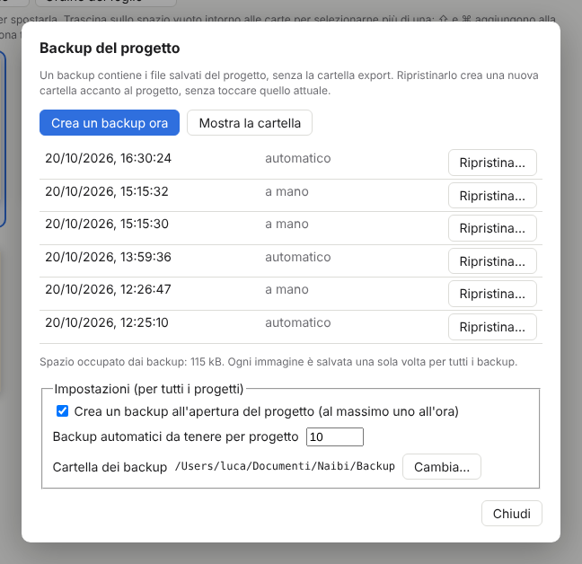

## 14. Importare da Tabletop Creator

**Importa da Tabletop Creator…** converte un progetto di Tabletop Creator in un progetto Naibi nuovo: template, set, variabili e immagini. La cartella originale viene solo letta.

Si indicano la cartella del progetto Tabletop Creator (quella con il file `.tcp` e la cartella `data`), la cartella del nuovo progetto, che deve essere nuova o vuota, e facoltativamente una cartella in cui cercare le icone della libreria. Le icone di game-icons.net e Kenney si prendono dai cataloghi dell'app.

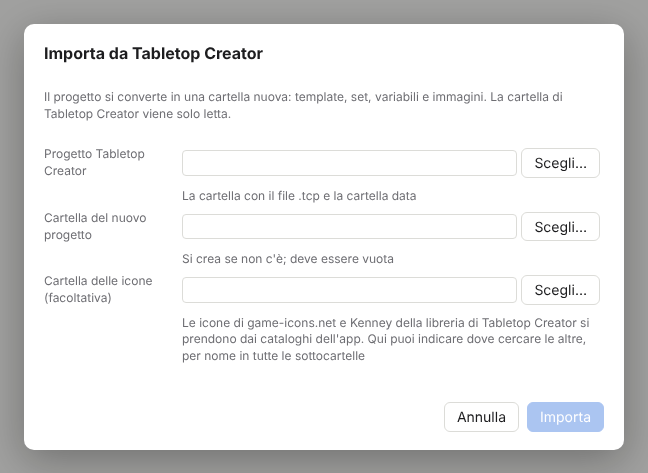

Al termine l'app elenca ciò che non ha potuto convertire, per esempio le maschere delle immagini e le immagini a 9 sezioni, e i font usati che non sono installati.

## 15. Lavorare con un agente IA

Un agente IA che esegue comandi sul computer (per esempio Claude Code, Codex o Cursor) può leggere e modificare i progetti Naibi, cercare i problemi e disegnare le carte per controllarle. Gli serve la **skill** di Naibi, un testo di istruzioni.

**Strumenti IA…**, nella schermata di ingresso e nella barra del progetto, mostra la skill con il comando `naibi` di questo computer già inserito:

1. **Copia la skill**.
2. Incollala nell'agente e chiedigli di installarla come skill (o come istruzioni del progetto, se non gestisce le skill). In alternativa **Salva come file…** la scrive in una cartella di skill; Claude Code le legge da `.claude/skills` nella cartella utente o in un progetto.
3. Chiedi all'agente quello che ti serve, indicando la cartella del progetto.

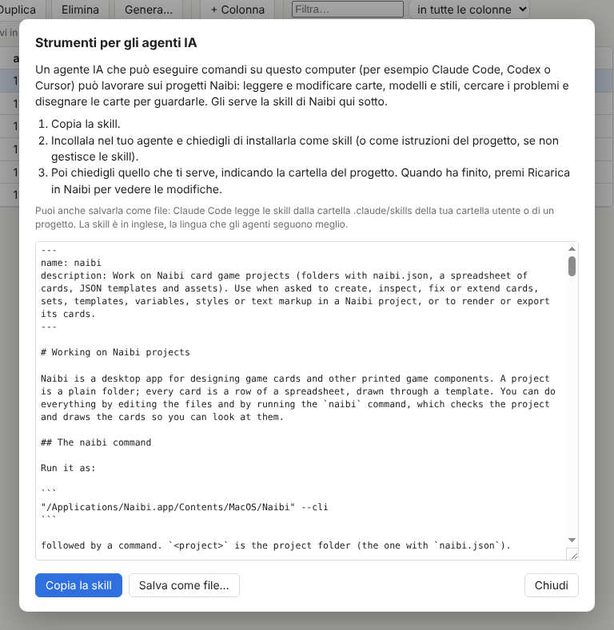

Il progetto può restare aperto in Naibi mentre l'agente lavora. Prima di modificarlo l'agente lo chiede all'app con `naibi begin`: se ci sono modifiche non salvate si ferma e ti chiede di salvare; altrimenti Naibi mostra che un'IA sta lavorando e non si usa finché l'agente non ha finito (`naibi end`), poi ricarica il progetto da solo. Se l'agente si interrompe senza sbloccare l'app, **Sblocca ora** la libera. Con una skill copiata prima della versione 1.2.0-beta.3 l'agente non lo sa fare: copiala di nuovo.

Il comando `naibi` si può usare anche direttamente, per esempio in uno script: `info` descrive il progetto, `check` elenca i problemi delle carte, `rows` e `set-rows` leggono e scrivono le righe di un set, `render` disegna le carte in PNG, `export` esegue un profilo di esportazione. I dettagli sono in [docs/cli.md](../cli.md).

## 16. I file del progetto

```
Esempio/
  naibi.json            nome, file dei dati, set, stili, variabili, profili di esportazione
  data/carte.xlsx       un foglio per set (o .ods, o .csv per un solo set)
  templates/<nome>.json un file per template
  docs/<nome>.md        documenti: regolamento, sell sheet, appendici
  notes/<nome>.md       note del progetto
  assets/               immagini e icone, anche in sottocartelle
  assets/fonts/         font del progetto
  assets/sources.json   provenienza e licenza di icone e font importati
  export/               file esportati, si possono rigenerare
  deleted/              template e fogli dei set eliminati, da cui si possono recuperare
```

Il progetto è autonomo: copiando la cartella su un altro computer si vede uguale, a parte i font installati solo sul primo. I dettagli del formato sono in [docs/formato.md](../formato.md).

## 17. Scorciatoie da tastiera

Su Windows e Linux ⌘ è Ctrl.

| Dove          | Tasti                 | Azione                                                                                                       |
| ------------- | --------------------- | ------------------------------------------------------------------------------------------------------------ |
| ovunque       | ⌘S                    | salva template, dati e impostazioni                                                                          |
| set           | ⌘Z, ⇧⌘Z               | annulla e ripete le modifiche ai dati                                                                        |
| set           | ⌘A, Esc               | seleziona tutte le carte, torna a una sola                                                                   |
| tabella       | Alt+Invio             | a capo dentro una cella                                                                                      |
| testo         | `{`, poi ↑ ↓, Invio   | suggerimenti di campi e variabili                                                                            |
| editor        | ⌘Z, ⇧⌘Z (o ⌘Y)        | annulla e ripete                                                                                             |
| editor        | T, R, E               | nuovo testo, rettangolo, ellisse                                                                             |
| editor        | ⌘D                    | duplica i livelli selezionati                                                                                |
| editor        | ⌘C, ⌘X, ⌘V            | copia, taglia e incolla livelli tra template                                                                 |
| editor        | ⌘G, ⇧⌘G               | raggruppa e separa                                                                                           |
| editor        | ⌘A                    | seleziona tutti i livelli                                                                                    |
| editor        | Canc                  | elimina i livelli selezionati                                                                                |
| editor        | frecce, ⇧ + frecce    | sposta di 0,5 mm o di 5 mm                                                                                   |
| editor        | Esc                   | toglie la selezione o esce dal gruppo                                                                        |
| tela          | Maiuscolo trascinando | sposta solo in orizzontale, in verticale o a 45°; inverte il blocco delle proporzioni; ruota a scatti di 15° |
| tela          | ⌘ ridimensionando     | ridimensiona dal centro                                                                                      |
| tela          | Alt trascinando       | sposta senza agganciarsi                                                                                     |
| tela, griglia | ⌘ + rotella           | zoom                                                                                                         |
